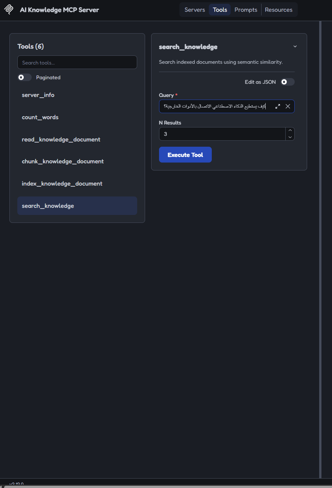
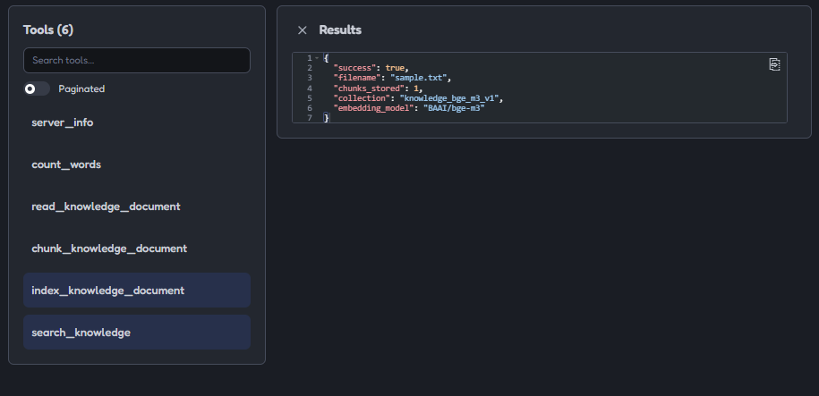
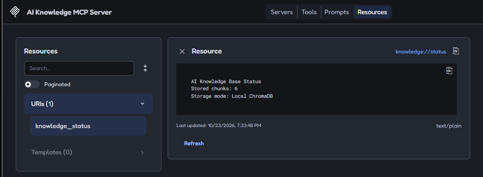
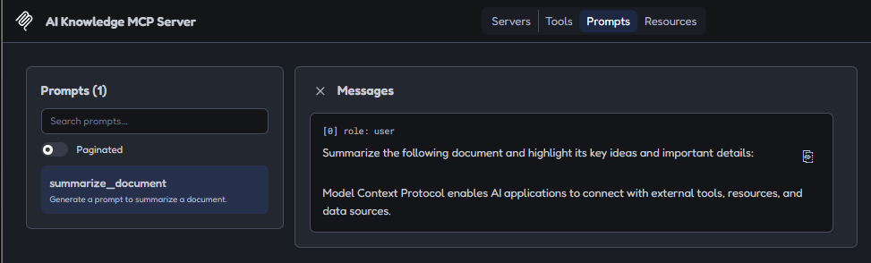
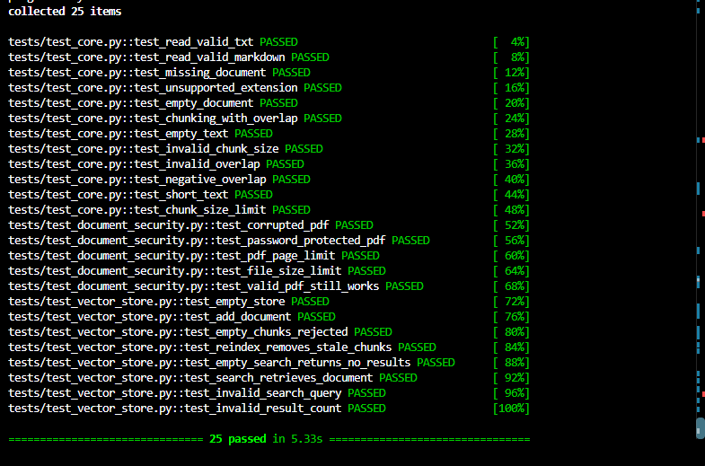
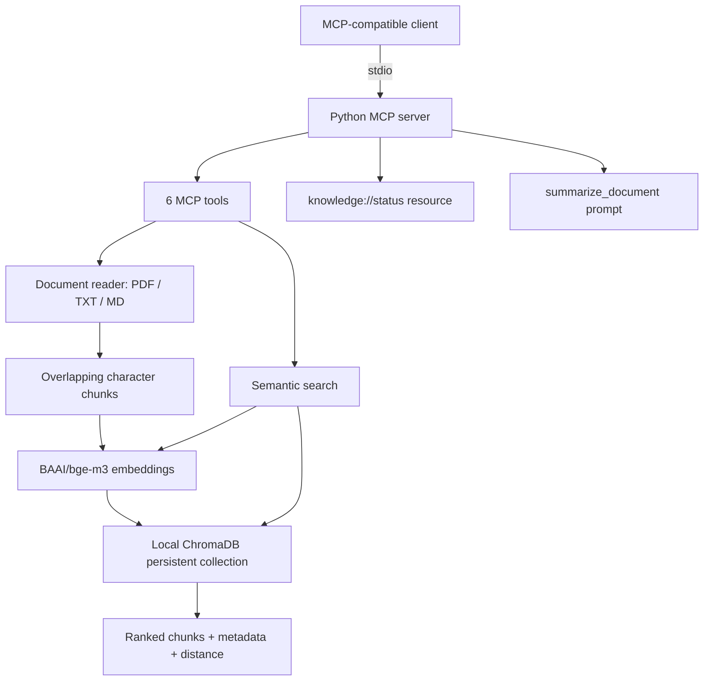

# AI Knowledge MCP Server

**Local-first multilingual document retrieval over the Model Context Protocol (MCP)**

A Python MCP server for reading, chunking, indexing, and semantically searching local PDF, TXT, and Markdown documents. It uses **BAAI/bge-m3** multilingual embeddings, **ChromaDB** persistent vector storage, and MCP tools, resources, and prompts. The project is an engineering portfolio prototype, not a hosted SaaS or production-hardened service.

**Stack:** Python 3.12 · MCP SDK · Sentence Transformers · BGE-M3 · PyTorch · ChromaDB · PyMuPDF · uv · pytest

## Demo

### MCP tools

Six tools exposed to an MCP-compatible client: `server_info`, `count_words`, `read_knowledge_document`, `chunk_knowledge_document`, `index_knowledge_document`, and `search_knowledge`.

<p align="center">
  
</p>

### Multilingual semantic search

An Arabic-language query retrieves relevant knowledge chunks, with filenames, metadata, and cosine distances. **Lower distance means closer similarity** in this collection.


### Document indexing

Indexing a sample text file into local ChromaDB using BGE-M3 embeddings.



### MCP resource

The `knowledge://status` resource reports the local vector store's status and chunk count.



### MCP prompt

The `summarize_document` prompt builds a summarization instruction from supplied text. **It does not itself run an LLM or produce a generated summary.**



### Automated tests

The latest locally verified test run completed **25/25 tests**.



## Architecture



The embedding service uses CUDA when available and otherwise falls back to CPU. Embeddings are 1,024-dimensional; the collection uses cosine distance. The server's default entry point uses **stdio**, not a publicly exposed HTTP endpoint.

## Capabilities

| Component | Implementation |
| --- | --- |
| MCP tools | Server info, word counts, document read/chunk/index, semantic search |
| MCP resource | `knowledge://status` |
| MCP prompt | `summarize_document` |
| Files | PDF, UTF-8 TXT, Markdown |
| Chunking | Configurable character window and overlap for the chunk tool; fixed defaults for indexing |
| Embeddings | Local multilingual BGE-M3 via Sentence Transformers |
| Storage | Local persistent ChromaDB collection |
| Reindexing | Updates a document's chunks and removes stale chunks in the tested normal path |
| Testing | pytest unit and document security regression tests |

## Quick start

### Requirements

\- Python **3.12** (development/tested version)

\- [`uv`](https://docs.astral.sh/uv/)

\- Internet access for initial installation and downloading model weights

\- Storage and memory appropriate for PyTorch and BGE-M3

The current dependency configuration selects **CUDA PyTorch on Windows** and **CPU PyTorch on Linux/macOS**. The Windows CUDA path was tested on an NVIDIA GPU; Linux CPU CI has not yet been verified.

### Installation

Clone the repository from its GitHub page, then run from the repository root:

```bash

uv sync --locked

```

Create a `documents/` directory, and add non-sensitive `.txt`, `.md`, or `.pdf` files. For example:

```text

documents/

  example.txt

  reference.pdf

```

**Important:** `documents/` is intentionally excluded from Git; example documents are not shipped with the repository.

### Run with an MCP-compatible client

```bash

uv run ai-knowledge-mcp-server

```

The command runs an MCP stdio server, so it is generally launched and communicated with by an MCP client rather than used as an interactive terminal app.

For local MCP Inspector development:

```bash

uv run mcp dev src/ai_knowledge_mcp_server/server.py

```

Do not expose the development Inspector to an untrusted network, and do not publish Inspector access/session tokens.

### Typical workflow

1. Add a supported document to `documents/`.

2. Call `read_knowledge_document` with its **filename**, not an arbitrary path.

3. Call `index_knowledge_document` with the filename.

4. Query with `search_knowledge`, e.g.:

```json

{

  "query": "كيف يستطيع الذكاء الاصطناعي الاتصال بالأدوات الخارجية؟",

  "n_results": 3

}

```

The search tool returns **retrieved passages and metadata**, not a generated natural-language answer or verified citation-based response.

## Development evaluation

The following metrics are from **small project-authored development test sets**. They are not an independent benchmark and should not be interpreted as production accuracy.

| Evaluation | Answerable cases | Reported results |
|---|---:|---|
| Initial multilingual retrieval | 4 | 4/4 correct top-1; Recall@3 100%; MRR@3 1.00 |
| Development questions | 24 | 24/24 correct top-1; Recall@3 100%; MRR@3 1.00 |
| Hard positive questions | 8 | 8/8 correct top-1; Recall@3 100%; MRR@3 1.00 |

The 30-question development set also included **6 unanswerable diagnostic questions**, which were **not** included in the 24-answerable-question retrieval scores. The hard-case set included **8 negative/out-of-scope questions**.

An experimental distance-only abstention rule evaluated on the same hard-case development set rejected all 8 negatives but also rejected 5 of the 8 valid questions (positive recall **37.5%**). **Reliable abstention is not implemented or claimed.** These experiments demonstrate why a distance threshold alone is insufficient.

Evaluation scripts are included at the repository root. Local evaluation reports in `reports/` are excluded from Git.

## Testing

```bash

uv run pytest tests/ -q

```

**Last locally observed result:** `25 passed` (Windows, Python 3.12). Tests cover document loading, chunking, path and size-related error cases, valid/corrupted/password-protected PDFs, page limits, isolated vector-store operations, searching, and normal reindexing. Vector-store unit tests use mock embeddings and isolated databases; they do **not** benchmark BGE-M3 retrieval quality.

The repository includes a GitHub Actions CPU workflow (`.github/workflows/tests.yml`). **Its hosted run is pending verification.** A Dockerfile is also included, but **Docker build/runtime verification is pending**; Docker is not installed on the development machine.

## Docker (configuration not yet verified)

The Dockerfile is intended to run an unprivileged MCP server over **stdio**, without published ports:

```bash

docker build -t ai-knowledge-mcp-server .

docker run --rm -i ai-knowledge-mcp-server

```

The image does not include local documents or ChromaDB content. External volumes would be required for durable storage across container lifetimes. **Do not treat these commands as a validated deployment recipe until the image builds and the MCP handshake is tested.**

## Security and privacy

This is a **local-first prototype**, not a completed security audit or production deployment.

\- The MCP tool interface restricts reads to a configured documents directory with filename/path validation. These checks do not eliminate every race or symbolic-link-related threat.

\- Document processing enforces **20 MiB file size**, **200 PDF page**, and **5,000,000 extracted character** limits; password-protected PDFs are rejected.

\- Parsed document text should be treated as **untrusted content**. It is not safe to promote instructions within retrieved documents to privileged system instructions.

\- `.gitignore` / `.dockerignore` exclude local documents, database data, virtual environments, secrets, and evaluation output; review staged files before publishing.

\- The ChromaDB version used during development (**1.5.9**) had **four distinct known vulnerability advisories** in the latest local dependency audit, some involving HTTP-server code execution or access controls. No fix version was reported by that audit. Keep the database local and do not expose a ChromaDB network service to untrusted users. Re-audit before deployment.

\- Publishing source to GitHub does **not** require hosting the server or exposing the development computer to inbound connections.

## Repository layout

```text

.

├── .github/workflows/tests.yml

├── assets/screenshots/

├── src/ai_knowledge_mcp_server/

│   ├── __init__.py

│   ├── server.py

│   ├── document_processor.py

│   ├── embedding_service.py

│   ├── text_chunker.py

│   └── vector_store.py

├── tests/

│   ├── test_core.py

│   ├── test_document_security.py

│   └── test_vector_store.py

├── evaluate_30_questions.py

├── evaluate_hard_cases.py

├── evaluate_abstention.py

├── test_bge_m3.py

├── test_multilingual_retrieval.py

├── test_reindexing.py

├── pyproject.toml

├── uv.lock

├── Dockerfile

├── .dockerignore

├── .gitignore

└── README.md

```

## Roadmap

\- Verify the hosted Linux CPU workflow and Docker build/runtime

\- Add MCP client/server integration tests

\- Add independent retrieval benchmarks and regression thresholds

\- Improve evidence checks and reliable abstention

\- Harden dependency security, sandboxing, and resource limits

\- Explore hybrid search, reranking, and optional answer generation


## Author & Contact

**Mohammad Ahmad Elayyan**  
Intelligent Systems Engineer | AI & LLM Engineer

Building AI-powered applications, intelligent agents, multilingual retrieval systems, and practical AI automation solutions.

- **Portfolio:** [mohammad-elayyan.netlify.app](https://mohammad-elayyan.netlify.app/)
- **GitHub:** [MohammadElayyan117](https://github.com/MohammadElayyan117)
- **LinkedIn:** [Mohammad Elayyan](https://www.linkedin.com/in/mohammadelayyan1/)
- **Email:** [mohamadelayyan84@gmail.com](mailto:mohamadelayyan84@gmail.com)

---

**Project Status:** v0.1.0 — Functional local prototype with verified unit tests. GitHub Actions and Docker execution are pending validation.

